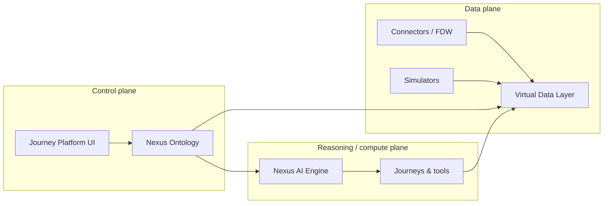

# NexusAI Data Platform

**The intelligent AI operating layer for the enterprise** — connect existing CRMs, ERPs, data warehouses, and SaaS tools; build a semantic knowledge graph; reason with governed AI; and run autonomous journeys and agents **without replacing your core systems**.

---

## Connect → Map → Reason → Execute

| Stage | What Nexus does |
|-------|-----------------|
| **Connect** | Pre-built connectors and APIs into enterprise systems — no wholesale migration. |
| **Map** | Semantic knowledge graph: entities, relationships, policies, Virtual Data Layer (VDL). |
| **Reason** | ReAct-style reasoning over connected context with audit trails. |
| **Execute** | Journey engine and AI Engine workers run production workflows with human-in-the-loop controls. |



---

## Documentation

| Resource | Link |
|----------|------|
| **Full documentation portal** | [nexus-docs](https://github.com/nexusdataai/nexus-docs) — business, architecture, operations, developer guide |
| **Published docs site** | [nexusdataai.github.io/nexus-docs](https://nexusdataai.github.io/nexus-docs/) *(when GitHub Pages is enabled on `nexus-docs`)* |
| **Executive summary** | [Business overview in docs](https://nexusdataai.github.io/nexus-docs/business/source/executive-summary/) |
| **Solution architecture** | [Technical architecture](https://nexusdataai.github.io/nexus-docs/technical/solution-architecture/) |

---

## Platform repositories

Core services are splitting from the historical **`nexus-backend`** / **`nexus-ui`** monolith into focused repos. New work should target the repos in the **Current platform** table.

### Current platform (recommended entry points)

| Repository | Role |
|------------|------|
| [**nexus-ontology**](https://github.com/nexusdataai/nexus-ontology) | **Control + data plane** — VDL, mapping, connectors, ontology & knowledge graph, MCP gateway, Journey Platform UI (FastAPI + React). |
| [**nexus-ai-engine**](https://github.com/nexusdataai/nexus-ai-engine) | **Compute / execution plane** — journey compilation, worker fleet, tool registry, schedules, runs, MCP/REST/SDK. |
| [**nexus-simulator**](https://github.com/nexusdataai/nexus-simulator) | **Enterprise data simulators** (SFDC, ERP, SAP, etc.) for dev/QA without live systems. |
| [**nexus-deployer**](https://github.com/nexusdataai/nexus-deployer) | **Customer toolkit & Kubernetes operator** — deploy Nexus capabilities to AWS / K8s. |
| [**nexus-docs**](https://github.com/nexusdataai/nexus-docs) | **MkDocs documentation** site (source of truth for product & engineering docs). |
| [**nexus-cli**](https://github.com/nexusdataai/nexus-cli) | Command-line tooling for operators and developers. |

### Deployment, domain, and reliability

| Repository | Role |
|------------|------|
| [**nexus-runtime**](https://github.com/nexusdataai/nexus-runtime) | Runtime packaging and execution support for deployed capabilities. |
| [**nexus-telco-plugin**](https://github.com/nexusdataai/nexus-telco-plugin) | Telco vertical plugins, ontologies, and solution assets. |
| [**nexus-sre**](https://github.com/nexusdataai/nexus-sre) | Autonomous SRE platform — incident reasoning, safe remediation, operational learning. |
| [**nexus-training**](https://github.com/nexusdataai/nexus-training) | Forward Deployed Engineer (FDE) training site and curriculum assets. |

### Legacy monolith (maintenance / extraction)

| Repository | Role |
|------------|------|
| [**nexus-backend**](https://github.com/nexusdataai/nexus-backend) | Historical FastAPI backend, MCP gateway, simulators (being extracted to **nexus-ontology**, **nexus-ai-engine**, **nexus-simulator**). |
| [**nexus-ui**](https://github.com/nexusdataai/nexus-ui) | Historical React console (superseded by UI in **nexus-ontology** and related repos). |

### Org meta

| Repository | Role |
|------------|------|
| [**`.github`**](https://github.com/nexusdataai/.github) | This organization profile and shared GitHub defaults. |

> **Tip for admins:** Pin up to six public repos on the org profile (e.g. `nexus-docs`, `nexus-ontology`, `nexus-ai-engine`, `nexus-simulator`, `nexus-deployer`, `nexus-cli`).

---

## Key capabilities

- **Virtual Data Layer** — query enterprise data by business names, not ad hoc SQL in every app.
- **AI Analytics** — dashboards, four-views framework, natural-language query builder.
- **AI Automation** — Journey Studio, schedules, webhooks, copilot-assisted journey design.
- **MCP & copilots** — HTTP MCP gateway, tool registry, streaming architecture for AI hosts.
- **AI-Ops for ontologies** — observability, governance, audit, and lifecycle around AI workloads.

---

## Getting started (developers)

1. Read the **[Developer Guide](https://nexusdataai.github.io/nexus-docs/developer/)** in `nexus-docs`.
2. Clone **`nexus-ontology`** for the control/data plane and UI; clone **`nexus-ai-engine`** for execution.
3. Use **`nexus-deployer`** (`kube-operator/`) for local K3s or EKS-style deployments.
4. Enable simulators via **`nexus-simulator`** when you need CRM/ERP data without production credentials.

Example clone set (adjust branches to your environment):

```bash
git clone https://github.com/nexusdataai/nexus-docs.git
git clone https://github.com/nexusdataai/nexus-ontology.git
git clone https://github.com/nexusdataai/nexus-ai-engine.git
git clone https://github.com/nexusdataai/nexus-deployer.git
```

---

## Support & community

- **Issues** — use the issue tracker on the repository you are working in.
- **Security** — see [SECURITY.md](../SECURITY.md) in this org defaults repo.
- **Contributing** — see [CONTRIBUTING.md](../CONTRIBUTING.md).

---

<p align="center">
  <sub>© Nexus Data AI · Organization profile maintained in <a href="https://github.com/nexusdataai/.github">nexusdataai/.github</a></sub>
</p>